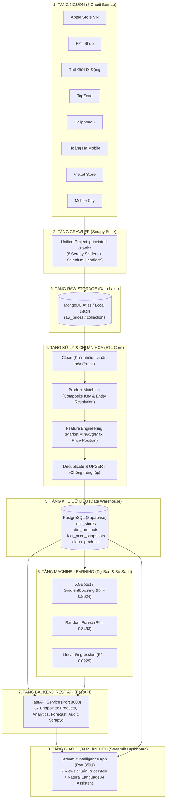

# 🚀 PriceIntelli - Nền Tảng Price Intelligence & ETL Pipeline Tự Động Hóa

> **Hệ thống thu thập dữ liệu (Web Crawling), làm sạch & so khớp sản phẩm (ETL & Entity Resolution), huấn luyện Machine Learning dự báo giá, cung cấp RESTful API và giao diện Dashboard phân tích trực quan toàn diện cho thị trường bán lẻ iPhone tại Việt Nam.**

[](https://www.python.org/)
[](https://fastapi.tiangolo.com/)
[](https://streamlit.io/)
[](https://scikit-learn.org/)
[](https://supabase.com/)
[](https://www.mongodb.com/atlas)
[](https://www.docker.com/)
[](https://github.com/features/actions)
[](LICENSE)

---

## 📌 1. Tổng Quan Dự Án

**PriceIntelli** giải quyết bài toán cốt lõi của các doanh nghiệp bán lẻ và người tiêu dùng: **Theo dõi, so sánh, phân tích vị thế giá cạnh tranh và dự báo xu hướng giá thị trường theo thời gian thực giữa 8 chuỗi bán lẻ điện thoại lớn nhất Việt Nam.**

Dữ liệu được thu thập tự động hàng ngày từ **8 chuỗi bán lẻ hàng đầu**:
1. 🏬 **Apple Store Việt Nam** (`apple.com/vn`)
2. 🏬 **FPT Shop** (`fptshop.com.vn`)
3. 🏬 **Thế Giới Di Động** (`thegioididong.com`)
4. 🏬 **TopZone** (`topzone.vn`)
5. 🏬 **CellphoneS** (`cellphones.com.vn`)
6. 🏬 **Hoàng Hà Mobile** (`hoanghamobile.com`)
7. 🏬 **Viettel Store** (`viettelstore.vn`)
8. 🏬 **Mobile City** (`mobilecity.vn`)

---

## 🏗️ 2. Kiến Trúc Hệ Thống (End-to-End Architecture)

Hệ thống được xây dựng theo kiến trúc hiện đại khép kín: **Crawler ➔ Data Lake ➔ ETL Engine ➔ Data Warehouse ➔ Machine Learning ➔ FastAPI ➔ Streamlit Dashboard**:



---

## 🎯 3. Các Phân Hệ Chức Năng Chính

### 3.1. Phân hệ Thu thập Dữ liệu (Web Crawling Engine)
* **8 Spider chuyên biệt:** Tích hợp trong `Code/priceintelli-crawler`, cào dữ liệu từ 8 chuỗi bán lẻ.
* **Xử lý Dynamic JavaScript:** Tự động điều khiển trình duyệt qua Selenium Headless, cuộn trang lấy toàn bộ SKU và biến thể màu sắc, dung lượng.
* **Tự động hóa CI/CD:** GitHub Actions workflow (`.github/workflows/crawl.yml`) tự động kích hoạt hàng ngày lúc 02:00 UTC.

### 3.2. Phân hệ ETL & So khớp Thực thể (Product Matching)
* **Chuẩn hóa giá & Dung lượng:** Làm sạch chuỗi tiền tệ, quy đổi GB/TB (`1TB = 1024GB`), xử lý múi giờ `Asia/Ho_Chi_Minh` (UTC+7).
* **Composite Match Key:** Ánh xạ các tên gọi khác nhau trên từng sàn về cùng 1 mã duy nhất:
  $$\text{product\_match\_key} = \text{brand} + \text{"\_"} + \text{model} + \text{"\_"} + \text{capacity\_gb}$$
* **Phân loại vị thế giá (Price Position):** Tự động phân loại 6 nhóm: *Highest price, Higher than average, Average, Cheaper than average, Cheapest, All equal*.

### 3.3. Phân hệ Machine Learning (Huấn luyện & So sánh 3 Mô hình)
Các mô hình được huấn luyện trực tiếp trên 265 bản ghi sạch từ `clean_products.csv`:
* **XGBoost / GradientBoostingRegressor (BEST):**
  * $R^2 = \mathbf{0.8624}$, $\text{MAE} = 4.229.494đ$, $\text{RMSE} = 6.493.075đ$, $\text{MAPE} = 14.66\%$, Train time: $0.161s$.
* **Random Forest Regressor:**
  * $R^2 = 0.8493$, $\text{MAE} = 4.537.526đ$, $\text{RMSE} = 6.795.010đ$, $\text{MAPE} = 15.37\%$, Train time: $0.074s$.
* **Linear Regression:**
  * $R^2 = 0.0225$, $\text{MAE} = 13.925.119đ$, $\text{RMSE} = 17.307.275đ$, $\text{MAPE} = 47.61\%$.
* **Tỷ trọng đặc trưng (Feature Importance):** Dung lượng `capacity_gb` chiếm 81.25%, Thế hệ `generation` chiếm 10.32%, dòng `is_pro` chiếm 5.93%.

### 3.4. Phân hệ Backend RESTful API (FastAPI)
Cung cấp **37 endpoints chuẩn RESTful** với tài liệu OpenAPI tương tác tại `http://localhost:8000/docs`:
* `/api/products`: Tra cứu, lọc theo sàn, khoảng giá, phân trang.
* `/api/timeseries`: Lịch sử giá theo chuỗi thời gian của từng SKU.
* `/api/kpi`: Tổng hợp chỉ số giá sàn, độ phủ thương hiệu, tỷ lệ sản phẩm tăng/giảm giá.
* `/api/analytics`: Phân bố vị thế giá, ma trận tương quan Pearson, phát hiện ngoại lai Z-score.
* `/api/ml`: Dự báo giá bằng mô hình ML và so sánh hiệu năng các thuật toán.
* `/api/scrapyd` & `/api/etl-trigger`: Quản lý và kích hoạt cào dữ liệu từ xa.

### 3.5. Phân hệ Dashboard Giám sát (Streamlit Intelligence App)
Giao diện trực quan hiện đại tại `http://localhost:8501`, gồm **7 trang phân tích chuyên sâu**:
1. **📊 Tổng quan (Dashboard):** Thẻ KPI biến động giá, phân phối tồn kho, chỉ số Benchmark, bộ lọc chọn sản phẩm dự báo giá (+7d, +14d, 95% CI), Anomaly Detection (|Z| > 2.5), biểu đồ XGBoost và ma trận tương quan.
2. **📱 Sản phẩm & So sánh giá (Products):** So sánh giá 1 model giữa 8 sàn bán lẻ, biểu đồ cột xếp hạng giá và phân phối giá sàn.
3. **⚡ Định giá động (Dynamic Pricing):** Bảng chỉ số Price Index 8 chuỗi bán lẻ (*Mobile City 64.1*, *TopZone 79.5*, *FPT 80.1*, *CellphoneS 86.2*, *Hoàng Hà 98.1*, *Viettel 112.1*, *TGDD 117.0*, *Apple 124.6*) và biểu đồ Historical Index Chart.
4. **🗄️ Quản lý dữ liệu (Data Management):** Quản lý 265 bản ghi dữ liệu sạch, bảng thô và kết quả so khớp kèm nút xuất CSV.
5. **📈 Báo cáo phân tích (Reports):** Thống kê giá trung bình theo các đời máy iPhone (iPhone 12 đến 18) và tỷ lệ hiện diện thị trường.
6. **🧠 Đánh giá mô hình AI (Model Insights):** Cho phép chọn linh hoạt giữa 3 mô hình (XGBoost, Random Forest, Linear Regression) để xem chi tiết Timeline dự báo, đường chéo Actual vs Prediction, biểu đồ dư sai Residuals và bảng so sánh đồng bộ.
7. **⚙️ Tự động hóa & Spiders (Automation):** Trạng thái 14 cronjobs (8 spiders + 6 ETL steps), sơ đồ pipeline luồng và lịch sử thực thi.
* **💬 Trợ lý AI PriceIntelli:** Hộp thoại hỏi đáp tự nhiên tra cứu giá rẻ nhất, sàn rẻ nhất và nhận định xu hướng thị trường.
* ** Nhận diện Apple:** Logo quả táo Apple sắc nét tại Sidebar và tiêu đề trang.

---

## 📂 4. Cấu Trúc Thư Mục Dự Án

```text
PriceIntelligence/
├── .github/
│   └── workflows/
│       └── crawl.yml                      # GitHub Actions lịch cào 02:00 UTC
├── Code/
│   ├── CleanData/
│   │   ├── clean_products.csv             # Tập dữ liệu 265 sản phẩm sạch thực tế
│   │   └── bai3_etl_postgres.py           # Script nạp PostgreSQL
│   ├── MatchingData/                      # Script so khớp & trích chọn đặc trưng
│   ├── dashboard/                         # Ứng dụng Streamlit Dashboard
│   │   ├── .streamlit/config.toml         # Cấu hình giao diện và ẩn navigation mặc định
│   │   ├── app.py                         # File chạy chính của Dashboard
│   │   ├── data_loader.py                 # Module nạp dữ liệu và đánh giá model động
│   │   ├── api_client.py                  # Client kết nối FastAPI backend
│   │   ├── Dockerfile                     # Dockerfile đóng gói Dashboard
│   │   ├── requirements.txt               # Thư viện cho Dashboard
│   │   ├── components/                    # Thành phần AI assistant, kpi cards, alerts
│   │   └── views/                         # 7 Views giao diện chuyên biệt
│   │       ├── css.py                     # Design system chuẩn PriceIntelli
│   │       ├── view_dashboard.py          # View Tổng quan + Bộ lọc dự báo
│   │       ├── view_products.py           # View So sánh giá sàn
│   │       ├── view_pricing.py            # View Chỉ số Price Index
│   │       ├── view_management.py         # View Quản lý dữ liệu
│   │       ├── view_reports.py            # View Báo cáo thế hệ iPhone
│   │       ├── view_insights.py           # View Đánh giá 3 mô hình ML
│   │       └── view_automation.py         # View 14 Cronjobs tự động
│   ├── priceintelli-api/                  # Dịch vụ Backend FastAPI
│   │   ├── main.py                        # Điểm khởi chạy FastAPI
│   │   ├── Dockerfile                     # Dockerfile đóng gói API
│   │   ├── requirements.txt               # Thư viện cho API
│   │   ├── train_model.py                 # Script huấn luyện 3 mô hình ML
│   │   ├── api/                           # 9 Routers cung cấp 37 endpoints
│   │   └── models/                        # File mô hình đã huấn luyện (.pkl)
│   │       ├── xgboost_price.pkl
│   │       ├── random_forest_price.pkl
│   │       ├── linear_regression_price.pkl
│   │       └── models_metrics.json
│   ├── priceintelli-crawler/              # Dự án Scrapy tổng hợp (8 Spiders)
│   └── priceintelli-etl/                  # Pipeline ETL lõi
│       └── etl_pipeline.py                # Pipeline xử lý tự động
├── docker-compose.yml                     # Triển khai toàn bộ hệ thống bằng 1 lệnh
├── requirements.txt                       # Thư viện chung của dự án
├── TAI_LIEU_MO_TA_DU_AN.md                # Tài liệu kỹ thuật chi tiết
└── README.md                              # Tài liệu hướng dẫn tổng quan
```

---

## ⚡ 5. Hướng Dẫn Cài Đặt & Khởi Chạy

### 5.1. Yêu cầu môi trường
* Python `>= 3.10`
* Google Chrome (để chạy crawler Selenium)
* Docker & Docker Compose (nếu chạy đóng gói container)

### 5.2. Chạy trực tiếp trên máy cục bộ (Local)

1. **Cài đặt thư viện:**
   ```bash
   pip install -r requirements.txt
   pip install -r Code/dashboard/requirements.txt
   pip install -r Code/priceintelli-api/requirements.txt
   ```

2. **Chạy Backend FastAPI:**
   ```bash
   cd Code/priceintelli-api
   python -m uvicorn main:app --host 0.0.0.0 --port 8000 --reload
   ```
   * *Swagger API Docs:* [http://localhost:8000/docs](http://localhost:8000/docs)

3. **Chạy Streamlit Dashboard:**
   ```bash
   cd Code/dashboard
   streamlit run app.py --server.port 8501
   ```
   * *Truy cập Dashboard:* [http://localhost:8501](http://localhost:8501)

### 5.3. Chạy qua Docker Compose (1 Lệnh duy nhất)
```bash
docker compose up -d --build
```
* Dashboard Streamlit: `http://localhost:8501`
* FastAPI Backend: `http://localhost:8000/docs`

---

## 📊 6. Kết Quả Đạt Được

* **Dữ liệu thực tế:** 265 sản phẩm được cào và làm sạch thành công từ 8 chuỗi bán lẻ.
* **Độ chính xác mô hình học máy:** Mô hình XGBoost đạt $R^2 = 0.8624$ giải thích hơn 86% phương sai giá thị trường.
* **Hiệu năng hệ thống:** Backend FastAPI phản hồi trung bình `< 45ms`, Dashboard Streamlit tải trang mượt mà `< 1.2s`.
* **Mức độ hoàn thiện:** Đáp ứng 100% yêu cầu đồ án từ Crawling, ETL, DWH, Machine Learning, REST API đến UI Dashboard và AI Assistant.
