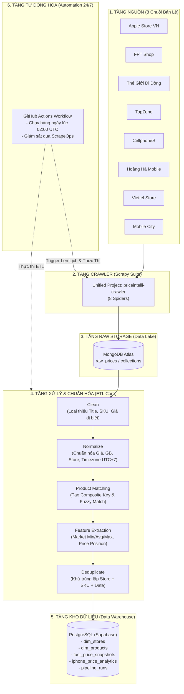

# 🚀 PriceIntelli - Nền Tảng Price Intelligence & ETL Pipeline Tự Động Hóa

> **Hệ thống thu thập (Web Crawling), chuẩn hóa (Data Normalization), so khớp sản phẩm (Product Matching), phân tích biến động giá thị trường (Price Intelligence) và tự động hóa vận hành (Automation) cho thị trường bán lẻ iPhone tại Việt Nam.**

[](https://www.python.org/)
[](https://scrapy.org/)
[](https://supabase.com/)
[](https://www.mongodb.com/atlas)
[](https://github.com/features/actions)
[](LICENSE)

---

## 📌 1. Tổng Quan Dự Án

**PriceIntelli** giải quyết bài toán cốt lõi của các doanh nghiệp bán lẻ và người tiêu dùng: **Theo dõi, so sánh và phân tích độ lệch giá thị trường theo thời gian thực giữa các chuỗi bán lẻ điện thoại lớn nhất Việt Nam.**

Dữ liệu được thu thập từ **8 chuỗi bán lẻ hàng đầu**:
1. 🏬 **Apple Store Việt Nam** (`apple.com/vn`)
2. 🏬 **FPT Shop** (`fptshop.com.vn`)
3. 🏬 **Thế Giới Di Động** (`thegioididong.com`)
4. 🏬 **TopZone** (`topzone.vn`)
5. 🏬 **CellphoneS** (`cellphones.com.vn`)
6. 🏬 **Hoàng Hà Mobile** (`hoanghamobile.com`)
7. 🏬 **Viettel Store** (`viettelstore.vn`)
8. 🏬 **Mobile City** (`mobilecity.vn`)

---

## 🏗️ 2. Kiến Trúc Hệ Thống (End-to-End Pipeline)

Hệ thống được thiết kế theo mô hình dữ liệu đa tầng (**Multi-tier Modern Data Stack**):



---

## 🎯 3. Các Tính Năng Nổi Bật

### 3.1. Hợp nhất Spider (Unified Scrapy Suite)
- Tích hợp toàn bộ 8 spider vào một dự án duy nhất `priceintelli-crawler`.
- Hỗ trợ giám sát phân tích thời gian thực với **ScrapeOps Monitoring SDK**.

### 3.2. Tiền xử lý & Làm sạch (Data Cleaning & Normalization)
- **Làm sạch:** Loại bỏ triệt để các sản phẩm rác, thiếu SKU, tiêu đề rỗng hoặc giá không hợp lệ ($0 < \text{Price} \le 200.000.000đ$).
- **Chuẩn hóa giá:** Loại bỏ ký tự tiền tệ, dấu chấm phân cách hàng nghìn, làm tròn đến 10.000đ.
- **Chuẩn hóa dung lượng:** Quy đổi mọi định dạng (`128GB`, `256 GB`, `512gb`, `1 TB`, `2TB`) về số nguyên `capacity_gb` chuẩn (`1TB = 1024GB`).
- **Múi giờ:** Đồng bộ toàn bộ dấu thời gian về `Asia/Ho_Chi_Minh` (UTC+7).

### 3.3. So khớp sản phẩm (Product Matching & Composite Key)
- Tách thuộc tính `brand`, `model`, `capacity_gb` để tạo khóa định danh toàn hệ thống:
  $$\text{product\_match\_key} = \text{brand} + \text{"\_"} + \text{model} + \text{"\_"} + \text{capacity\_gb}$$
  *Ví dụ:* Cả `iPhone 16 128GB - Trắng` (FPT Shop) và `iPhone 16 128GB White` (Apple Store) đều được ánh xạ về cùng một mã duy nhất: **`apple_16_128`**.
- **Fuzzy Matching & Hard Filter:** 
  - Triển khai 3 thuật toán: *Levenshtein Distance*, *Jaccard Similarity*, *Token Sort Ratio*.
  - Tiền xử lý từ viết tắt (*Synonym Mapping*: `ip` $\to$ `iphone`, `prm` $\to$ `pro max`) và loại từ rác (*Stopwords Removal*: `chinh hang`, `vn/a`, `moi fullbox`, `tra gop 0%`).
  - **Bộ lọc cứng (Hard Filter):** Ngăn chặn so khớp nhầm giữa dòng thường và dòng Pro Max.

### 3.4. Trích chọn đặc trưng giá lõi (Price Intelligence)
- **Market Price:** Tính giá thấp nhất thị trường (`market_min`), giá cao nhất (`market_max`), giá trung bình (`market_avg`), giá trung vị (`market_median`).
- **Price Difference:** Tính độ lệch giá tuyệt đối (`price_diff_vs_avg`, `price_diff_vs_min`) và tỷ lệ phần trăm (`price_diff_pct`).
- **Price Position:** Phân loại vị thế giá của từng sàn:
  - `Best Price (Cheapest)`: Rẻ nhất thị trường.
  - `Below Average`: Thấp hơn mức trung bình thị trường.
  - `Above Average`: Cao hơn mức trung bình thị trường.
  - `Highest Price`: Đắt nhất thị trường.
  - `Equal Price`: Mức giá đồng nhất trên mọi sàn.

### 3.5. Phát hiện ngoại lai (Outlier Detection)
- Phát hiện các bất thường về giá nhập liệu / lỗi crawl (ví dụ: cào nhầm dung lượng `512đ` làm giá bán):
  - Phương pháp **IQR** (Interquartile Range): $[Q_1 - 1.5 \times IQR, Q_3 + 1.5 \times IQR]$.
  - Phương pháp **Z-Score**: $|Z| > 2.0$.
  - Trực quan hóa qua biểu đồ **Boxplot & Stripplot**.

### 3.6. Cơ chế nạp chống trùng lặp (UPSERT & Idempotency)
- Bảng `fact_price_snapshots` sử dụng ràng buộc duy nhất:
  $$\text{CONSTRAINT } uq\_snapshot \text{ UNIQUE (product\_id, store\_id, crawl\_date)}$$
- Khi chạy lại nhiều lần trong ngày, hệ thống tự động cập nhật bản ghi mới nhất (**UPSERT**) thay vì chèn trùng lặp, đảm bảo tính bất biến (*Idempotent*).
- Bảng `pipeline_runs` tự động lưu vết audit log cho từng phiên chạy.

---

## 📂 4. Cấu Trúc Thư Mục Dự Án

```
├── .github/
│   └── workflows/
│       └── crawl.yml                 # Workflow CI/CD tự động hóa chạy hàng ngày trên GitHub Actions
├── Code/
│   ├── priceintelli-crawler/         # Dự án Scrapy hợp nhất 8 spider
│   │   ├── scrapy.cfg                # File cấu hình deploy
│   │   └── priceintelli/
│   │       ├── items.py              # Định nghĩa schema Item chung
│   │       ├── pipelines.py          # Pipeline đẩy dữ liệu vào MongoDB Atlas
│   │       ├── settings.py           # Thiết lập User-Agent, Rate limit, ScrapeOps
│   │       └── spiders/              # 8 Spiders: apple_vn, fptshop, thegioididong, topzone,
│   │                                 #           cellphones, hoanghamobile, viettelstore, mobilecity
│   ├── priceintelli-etl/             # Module ETL cốt lõi cho Production
│   │   ├── etl_pipeline.py           # Script Extract -> Clean -> Normalize -> UPSERT PostgreSQL
│   │   └── .env                      # File cấu hình môi trường (được bảo vệ qua .gitignore)
│   ├── buoi4/                        # Script thực hành Buổi 4 (Normalize, Deduplicate, ETL cơ bản)
│   └── buoi5/                        # Script thực hành Buổi 5 (Fuzzy Match, Price Analytics, Boxplot)
│       ├── bai1_data_profiling.py
│       ├── bai2_feature_extraction.py
│       ├── bai3_etl_features_postgres.py
│       ├── bai4_fuzzy_matching.py
│       ├── bai5_price_analytics.py
│       ├── bai6_plot_price_trends.py
│       └── bai7_outlier_detection.py
├── requirements.txt                  # Danh mục thư viện Python
├── .gitignore                        # Loại trừ file rác, venv, và credentials bảo mật
└── README.md                         # Tài liệu hướng dẫn dự án
```

---

## 🗄️ 5. Thiết Kế Cơ Sở Dữ Liệu (Data Warehouse Schema)

### Bảng `dim_stores`
| Cột | Kiểu dữ liệu | Mô tả |
| :--- | :--- | :--- |
| `store_id` | SERIAL PRIMARY KEY | Khóa chính |
| `store_name` | VARCHAR(100) UNIQUE | Tên chuỗi bán lẻ chuẩn |
| `website_url`| VARCHAR(255) | Trang chủ cửa hàng |
| `created_at` | TIMESTAMPTZ | Ngày tạo bản ghi |

### Bảng `dim_products`
| Cột | Kiểu dữ liệu | Mô tả |
| :--- | :--- | :--- |
| `product_id` | SERIAL PRIMARY KEY | Khóa chính |
| `product_name`| TEXT UNIQUE | Tên sản phẩm chuẩn kèm dung lượng |
| `brand` | VARCHAR(50) | Thương hiệu (Apple) |
| `created_at` | TIMESTAMPTZ | Ngày tạo bản ghi |

### Bảng `fact_price_snapshots`
| Cột | Kiểu dữ liệu | Mô tả |
| :--- | :--- | :--- |
| `snapshot_id`| BIGSERIAL PRIMARY KEY | Khóa chính |
| `product_id` | INT REFERENCES dim_products | Mã sản phẩm |
| `store_id` | INT REFERENCES dim_stores | Mã cửa hàng |
| `crawled_at` | TIMESTAMPTZ | Thời điểm cào |
| `crawl_date` | DATE | Ngày cào dữ liệu |
| `price` | BIGINT | Giá bán thực tế (VND) |
| `listed_price`| BIGINT | Giá niêm yết cũ (VND) |
| `in_stock` | BOOLEAN | Trạng thái còn hàng |
| `reviews` | INT | Số lượt đánh giá |
| **Ràng buộc** | **UNIQUE (product_id, store_id, crawl_date)** | **Chống trùng lặp theo ngày** |

### Bảng `pipeline_runs` (Audit Logging)
| Cột | Kiểu dữ liệu | Mô tả |
| :--- | :--- | :--- |
| `run_id` | BIGSERIAL PRIMARY KEY | Khóa chính |
| `job_name` | VARCHAR(100) | Tên tác vụ (`etl_pipeline`) |
| `started_at` | TIMESTAMPTZ | Thời điểm bắt đầu |
| `finished_at`| TIMESTAMPTZ | Thời điểm kết thúc |
| `status` | VARCHAR(20) | Trạng thái (`success` / `failed`) |
| `records_processed` | INT | Số bản ghi nạp thành công |
| `error_message` | TEXT | Chi tiết thông báo lỗi (nếu có) |

---

## 🛠️ 6. Hướng Dẫn Cài Đặt & Chạy Local

### 6.1. Yêu cầu hệ thống
- Python 3.11 trở lên
- Git
- Kết nối Internet đến MongoDB Atlas và PostgreSQL (Supabase)

### 6.2. Thiết lập môi trường ảo
```bash
# Tạo môi trường ảo
python -m venv .venv

# Kích hoạt môi trường ảo
# Trên Windows (PowerShell):
.\.venv\Scripts\Activate.ps1
# Trên macOS / Linux:
source .venv/bin/activate

# Cài đặt thư viện
pip install -r requirements.txt
```

### 6.3. Cấu hình biến môi trường
Tạo file `.env` tại thư mục gốc hoặc trong `Code/priceintelli-etl/.env`:
```env
MONGODB_URI="mongodb+srv://<username>:<password>@cluster0.xxxx.mongodb.net/?appName=Cluster0"
MONGODB_DB=imdb

SUPABASE_DB_URL="postgresql+psycopg://postgres.<project-ref>:<password>@aws-0-ap-southeast-1.pooler.supabase.com:6543/postgres"
PGSSLMODE=require
SCRAPEOPS_API_KEY="<api-key-cua-ban>"
```

### 6.4. Chạy kiểm thử các thành phần

#### 1. Kiểm tra 8 Spider Scrapy
```bash
cd Code/priceintelli-crawler
scrapy list
# Chạy thử 1 spider (ví dụ FPT Shop):
scrapy crawl fptshop
```

#### 2. Chạy luồng ETL Pipeline nạp vào PostgreSQL
```bash
cd Code/priceintelli-etl
python etl_pipeline.py
```

#### 3. Chạy phân tích đặc trưng giá & vẽ biểu đồ (Bài 5)
```bash
cd Code/buoi5
# Chạy phân tích đặc trưng giá thị trường:
python bai5_price_analytics.py

# Vẽ biểu đồ biến động giá Line Chart:
python bai6_plot_price_trends.py

# Phân tích phát hiện ngoại lệ Outliers Boxplot:
python bai7_outlier_detection.py
```

---

## ☁️ 7. Hướng Dẫn Triển Khai Tự Động Với GitHub Actions

### Bước 1: Đẩy mã nguồn lên GitHub
```bash
git remote add origin https://github.com/<username>/<repo-name>.git
git branch -M main
git push -u origin main
```

### Bước 2: Cài đặt GitHub Secrets
Vào GitHub Repository $\to$ **Settings** $\to$ **Secrets and variables** $\to$ **Actions** $\to$ **New repository secret**:
- `MONGO_URI`: Chuỗi kết nối MongoDB Atlas.
- `POSTGRES_URL`: Chuỗi kết nối PostgreSQL Supabase (Session Pooler cổng 6543).
- `SCRAPEOPS_API_KEY`: API Key lấy từ [ScrapeOps](https://scrapeops.io).

### Bước 3: Cấu hình mở IP kết nối
- **MongoDB Atlas:** Vào `Security` $\to$ `Network Access` $\to$ chọn `Add IP Address` $\to$ nhập `0.0.0.0/0` (Allow Access from Anywhere).
- **Supabase:** Session Pooler hỗ trợ kết nối toàn cầu qua IPv4/IPv6.

### Bước 4: Kích hoạt chạy thủ công hoặc chờ chạy định kỳ
- Vào tab **Actions** trên GitHub $\to$ Chọn workflow **Daily Crawl and ETL** $\to$ Nhấn **Run workflow**.
- Workflow sẽ tự động thực thi định kỳ lúc **02:00 UTC (09:00 sáng hàng ngày giờ VN)**.

---


