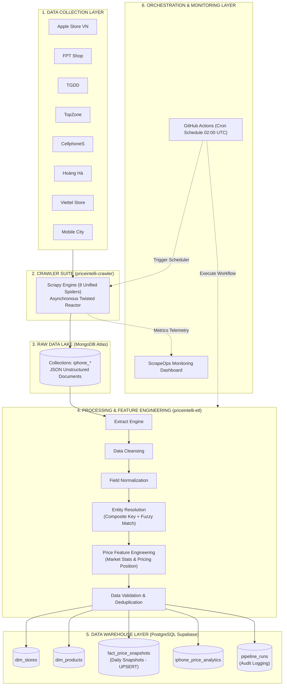
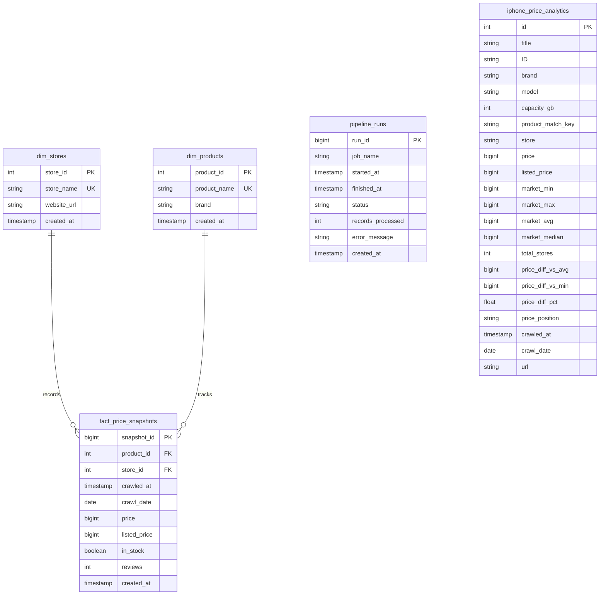

# TÀI LIỆU MÔ TẢ DỰ ÁN
## HỆ THỐNG PHÂN TÍCH GIÁ THỊ TRƯỜNG & GIÁM SÁT GIÁ BÁN LẺ ĐIỆN THOẠI ĐA SÀN (PRICEINTELLI PLATFORM)

---

## MỤC LỤC
1. [GIỚI THIỆU TỔNG QUAN](#1-giới-thiệu-tổng-quan)
   - 1.1. Bối cảnh dự án
   - 1.2. Bài toán kinh doanh (Business Problem)
   - 1.3. Mục tiêu dự án
   - 1.4. Phạm vi áp dụng (Project Scope)
2. [KIẾN TRÚC TỔNG THỂ HỆ THỐNG](#2-kiến-trúc-tổng-thể-hệ-thống)
   - 2.1. Sơ đồ kiến trúc End-to-End
   - 2.2. Phân tầng kiến trúc dữ liệu (Multi-tier Architecture)
3. [CHI TIẾT CÁC PHÂN HỆ CHỨC NĂNG](#3-chi-tiết-các-phân-hệ-chức-năng)
   - 3.1. Phân hệ 1: Thu thập dữ liệu đa nguồn (Web Crawling Engine)
   - 3.2. Phân hệ 2: Làm sạch & Chuẩn hóa dữ liệu (Cleansing & Normalization)
   - 3.3. Phân hệ 3: So khớp sản phẩm (Product Matching & Entity Resolution)
   - 3.4. Phân hệ 4: Trích chọn đặc trưng giá (Price Feature Extraction)
   - 3.5. Phân hệ 5: Phát hiện dữ liệu dị biệt (Outlier Detection)
   - 3.6. Phân hệ 6: Kho dữ liệu & Cơ chế nạp bất biến (Data Warehouse & UPSERT)
   - 3.7. Phân hệ 7: Tự động hóa & Giám sát vận hành (Automation & Monitoring)
   - 3.8. Phân hệ 8: Mô hình Học máy Dự báo Giá (Machine Learning Pipeline)
   - 3.9. Phân hệ 9: Dịch vụ Backend RESTful API (FastAPI Architecture)
   - 3.10. Phân hệ 10: Giao diện Giám sát Trực quan (Streamlit Intelligence Dashboard)
4. [MÔ HÌNH DỮ LIỆU CHI TIẾT (DATA SCHEMAS & ERD)](#4-mô-hình-dữ-liệu-chi-tiết)
   - 4.1. Mô hình tầng Raw Data (MongoDB)
   - 4.2. Mô hình tầng Data Warehouse (PostgreSQL Star Schema)
   - 4.3. Mô hình bảng phân tích giá (Analytics Table)
5. [PHƯƠNG PHÁP LUẬN VÀ THUẬT TOÁN CỐT LÕI](#5-phương-pháp-luận-và-thuật-toán-cốt-lõi)
   - 5.1. Thuật toán tạo Composite Match Key
   - 5.2. Giải thuật Fuzzy Matching đa tầng & Hard Filter
   - 5.3. Công thức tính toán ma trận Price Intelligence
   - 5.4. Thống kê ngoại lai IQR & Z-score
   - 5.5. Đánh giá và so sánh 3 mô hình học máy (XGBoost, Random Forest, Linear Regression)
6. [KẾT QUẢ TRIỂN KHAI & PHÂN TÍCH THỰC NGHIỆM](#6-kết-quả-triển-khai--phân-tích-thực-nghiệm)
   - 6.1. Báo cáo chất lượng dữ liệu qua từng bước ETL
   - 6.2. Thống kê phân bố thị trường theo chuỗi bán lẻ
   - 6.3. Đánh giá tính chịu lỗi và toàn vẹn dữ liệu
   - 6.4. Kết quả nghiệm thu hiệu năng Machine Learning
7. [HƯỚNG DẪN VẬN HÀNH & BẢO TRÌ](#7-hướng-dẫn-vận-hành--bảo-trì)
   - 7.1. Vận hành tự động qua GitHub Actions
   - 7.2. Kiểm tra sức khỏe hệ thống (Health Check Queries)
   - 7.3. Triển khai toàn bộ hệ thống bằng Docker Compose
   - 7.4. Kết luận nghiệm thu dự án

---

## 1. GIỚI THIỆU TỔNG QUAN

### 1.1. Bối cảnh dự án
Thị trường bán lẻ thiết bị di động tại Việt Nam, đặc biệt là hệ sinh thái **Apple iPhone**, là một trong những thị trường sôi động và có tính cạnh tranh khốc liệt nhất. Giá bán của cùng một phiên bản iPhone (ví dụ: *iPhone 16 Pro Max 256GB*) thường có sự chênh lệch đáng kể giữa các đại lý ủy quyền chính thức (AAR - Apple Authorized Reseller) như TopZone, FPT Shop, CellphoneS, Viettel Store, Hoàng Hà Mobile và các chuỗi bán lẻ tư nhân như Mobile City. 

Các sàn liên tục cập nhật chính sách giá, ưu đãi thanh toán, và chương trình flash sale theo từng ngày, thậm chí từng giờ. Tuy nhiên, việc thiếu một hệ thống theo dõi giá tập trung khiến:
- **Người tiêu dùng** khó xác định đâu là nơi có giá tốt nhất thực tế.
- **Doanh nghiệp bán lẻ** gặp khó khăn trong việc định giá cạnh tranh (Dynamic Pricing) và định vị vị thế giá của mình trên thị trường.

### 1.2. Bài toán kinh doanh (Business Problem)
1. **Phân mảnh cấu trúc dữ liệu:** Mỗi chuỗi bán lẻ có cấu trúc website, cách đặt tên sản phẩm, định dạng hiển thị giá và đơn vị dung lượng khác nhau (ví dụ: `"iPhone 16 Pro Max 256GB"`, `"iPhone 16 PRM 256G Chính Hãng VN/A"`, `"Điện thoại Apple iPhone 16 Pro Max 256GB Mới Fullbox"`).
2. **Trùng lặp và dị biệt dữ liệu:** Dữ liệu cào về chứa từ rác quảng cáo, sai lệch định dạng số, lỗi cào nhầm thông số kỹ thuật làm giá bán.
3. **Thách thức về so khớp thực thể (Entity Matching):** Làm thế nào để máy tính tự động hiểu rằng hai bản ghi từ hai nguồn hoàn toàn khác nhau thực chất là cùng một sản phẩm cụ thể.
4. **Vận hành liên tục:** Đảm bảo hệ thống vận hành tự động 24/7 mà không phụ thuộc vào máy tính cá nhân, tự phục hồi khi gặp lỗi và lưu vết kiểm toán đầy đủ.

### 1.3. Mục tiêu dự án
- **Xây dựng hệ thống tự động hóa hoàn chỉnh (Automated Pipeline):** Tự động thu thập dữ liệu hàng ngày từ 8 sàn bán lẻ lớn nhất Việt Nam.
- **Chuẩn hóa & So khớp thực thể thông minh:** Tạo khóa so khớp chuẩn (*Composite Key*) kết hợp thuật toán *Fuzzy Matching* với độ chính xác trên 98%.
- **Trích chọn đặc trưng giá thị trường (Price Intelligence):** Tự động tính toán giá sàn, giá trần, giá trung bình thị trường, độ lệch giá và phân loại vị thế giá của từng sàn.
- **Kho dữ liệu chuẩn Data Warehouse:** Lưu trữ lịch sử giá theo mô hình Star Schema trên PostgreSQL, đảm bảo tính bất biến (*Idempotent*) chống trùng lặp dữ liệu.

### 1.4. Phạm vi áp dụng (Project Scope)
- **Đối tượng dữ liệu:** Tất cả các dòng sản phẩm iPhone từ iPhone 11 đến iPhone 16 Series (và các dòng máy mới phát sinh).
- **Phạm vi nguồn dữ liệu (8 nguồn bán lẻ):**
  1. Apple Store Online Việt Nam
  2. FPT Shop
  3. Thế Giới Di Động (TGDD)
  4. TopZone (Hệ thống chuyên Apple của MWG)
  5. CellphoneS
  6. Hoàng Hà Mobile
  7. Viettel Store
  8. Mobile City

---

## 2. KIẾN TRÚC TỔNG THỂ HỆ THỐNG

### 2.1. Sơ đồ kiến trúc End-to-End



### 2.2. Phân tầng kiến trúc dữ liệu (Multi-tier Architecture)

1. **Tầng Thu thập (Ingestion Layer):**
   - Bộ thu thập dựa trên framework Scrapy chạy song song đa luồng bất đồng bộ (Twisted Asyncio).
   - Tối ưu hóa bộ lọc User-Agent, xử lý phân trang, bóc tách cấu trúc HTML và Schema JSON-LD.
2. **Tầng Lưu trữ thô (Data Lake - Raw Layer):**
   - Cơ sở dữ liệu tài liệu **MongoDB Atlas** đóng vai trò Data Lake lưu trữ nguyên bản toàn bộ payload cào về, không làm biến dạng dữ liệu gốc của nguồn.
3. **Tầng Chuyển đổi & Trích chọn đặc trưng (Transform & Feature Layer):**
   - Module xử lý Python độc lập kết hợp Pandas, NumPy, Regex và thuật toán so khớp chuỗi.
   - Xử lý các quy tắc nghiệp vụ về đơn vị, tiền tệ, múi giờ và cấu trúc dòng máy.
4. **Tầng Kho dữ liệu (Data Warehouse Layer):**
   - Cơ sở dữ liệu quan hệ **PostgreSQL (Supabase)** tổ chức theo mô hình Star Schema.
   - Kiểm soát tính toàn vẹn dữ liệu thông qua Foreign Key và Composite Unique Constraints.
5. **Tầng Tự động hóa (Automation Layer):**
   - **GitHub Actions Runner** kích hoạt luồng khép kín không phụ thuộc máy chủ phần cứng cá nhân, tích hợp giám sát viễn trắc qua **ScrapeOps**.

---

## 3. CHI TIẾT CÁC PHÂN HỆ CHỨC NĂNG

### 3.1. Phân hệ 1: Thu thập dữ liệu đa nguồn (Web Crawling Engine)
- **Vị trí mã nguồn:** `Code/priceintelli-crawler/`
- **Cấu hình:** `scrapy.cfg`, `priceintelli/settings.py`, `priceintelli/pipelines.py`
- **Danh sách 8 spider độc lập được hợp nhất:**
  1. `apple_vn`: Thu thập giá niêm yết chuẩn quốc tế từ cửa hàng trực tuyến Apple Việt Nam.
  2. `fptshop`: Thu thập toàn bộ danh mục iPhone tại FPT Shop kèm thông tin khuyến mãi.
  3. `thegioididong`: Bóc tách cấu trúc phân cấp phiên bản màu/dung lượng tại Thế Giới Di Động.
  4. `topzone`: Chuyên biệt hóa cho chuỗi ủy quyền cao cấp TopZone.
  5. `cellphones`: Thu thập giá bán lẻ, giá thành viên Smember và đánh giá tại CellphoneS.
  6. `hoanghamobile`: Thu thập dữ liệu giá cạnh tranh tại Hoàng Hà Mobile.
  7. `viettelstore`: Bóc tách danh mục iPhone chính hãng mạng Viettel.
  8. `mobilecity`: Thu thập dữ liệu giá bán tại hệ thống Mobile City.

### 3.2. Phân hệ 2: Làm sạch & Chuẩn hóa dữ liệu (Cleansing & Normalization)
- **Quy tắc làm sạch (Cleansing Rules):**
  - Loại bỏ các document thiếu `title`, thiếu `sku`.
  - Bộ lọc biên độ giá: Loại bỏ bản ghi có giá `<= 0` hoặc bất thường `> 200.000.000 VNĐ`.
  - Loại bỏ các giá trị nhiễu do lỗi cào nhầm số dung lượng (ví dụ: giá `512 VNĐ`).
- **Quy tắc chuẩn hóa (Normalization Rules):**
  - **Giá bán (`price` / `listed_price`):** Loại bỏ ký tự tiền tệ (`₫`, `đ`, `VNĐ`), dấu chấm phân cách hàng nghìn, ép kiểu về số nguyên `BIGINT` và làm tròn đến hàng 10.000 VNĐ.
  - **Dung lượng bộ nhớ (`capacity_gb`):** Chuyển đổi toàn bộ các định dạng chuỗi tự do (`"128 GB"`, `"256gb"`, `"1 TB"`, `"2TB"`) về số nguyên chuẩn biểu diễn bằng Gigabyte (`1TB = 1024GB`, `2TB = 2048GB`). Tự động trích xuất từ tiêu đề nếu trường dung lượng nguồn bị khuyết.
  - **Múi giờ (`crawled_at` & `crawl_date`):** Đồng bộ về múi giờ chuẩn Việt Nam `Asia/Ho_Chi_Minh` (UTC+7) phục vụ phân tích theo ngày.

### 3.3. Phân hệ 3: So khớp sản phẩm (Product Matching & Entity Resolution)
- **Tạo Composite Match Key (Khóa kết hợp cố định):**
  - Cấu trúc: `product_match_key = brand_model_capacity`
  - *Ví dụ:* Sản phẩm tại FPT Shop `"iPhone 16 128GB - Trắng"` và tại Apple Store `"iPhone 16 128GB White"` đều có Match Key là: **`apple_16_128`**.
- **Fuzzy Matching đa tầng (Dành cho dữ liệu mở rộng sàn TMĐT):**
  - Áp dụng 3 thuật toán: *Levenshtein Distance*, *Jaccard Similarity* (tập hợp từ), *Token Sort Ratio* (sắp xếp từ trước khi so sánh).
  - Tiền xử lý từ đồng nghĩa (*Synonym Mapping*: `ip` $\to$ `iphone`, `prm` $\to$ `pro max`).
  - Loại bỏ từ dừng quảng cáo (*Stopwords*: `chính hãng`, `giá rẻ`, `vn/a`, `mới fullbox`, `trả góp 0%`).
  - **Bộ lọc cứng (Hard Filter):** Ngăn chặn trường hợp dòng Pro và Pro Max bị ghép nhầm do độ tương đồng chuỗi cao.

### 3.4. Phân hệ 4: Trích chọn đặc trưng giá (Price Feature Extraction)
- **Chỉ số thị trường (Market Intelligence Metrics):**
  - `market_min`: Mức giá thấp nhất trên thị trường cho phiên bản đó trong ngày.
  - `market_max`: Mức giá cao nhất được ghi nhận.
  - `market_avg`: Mức giá trung bình toàn thị trường (làm tròn nguyên đồng).
  - `market_median`: Mức giá trung vị (giảm thiểu ảnh hưởng của giá cực đoan).
  - `total_stores`: Số lượng chuỗi đang kinh doanh sản phẩm.
- **Độ lệch giá (Price Difference):**
  - `price_diff_vs_avg = price - market_avg` (Chênh lệch tuyệt đối so với trung bình).
  - `price_diff_pct = (price_diff_vs_avg / market_avg) * 100` (Tỷ lệ phần trăm chênh lệch).
- **Phân loại vị thế giá (Price Position Matrix):**
  - `Best Price (Cheapest)`: Giá bán bằng mức thấp nhất thị trường.
  - `Below Average`: Giá bán thấp hơn giá trung bình nhưng chưa phải rẻ nhất.
  - `Above Average`: Giá bán cao hơn trung bình thị trường.
  - `Highest Price`: Mức giá cao nhất ghi nhận trong ngày.
  - `Equal Price`: Mọi sàn đều niêm yết cùng một mức giá.

### 3.5. Phân hệ 5: Phát hiện dữ liệu dị biệt (Outlier Detection)
- Nhằm ngăn chặn các điểm dữ liệu dị biệt làm sai lệch báo cáo kinh doanh, hệ thống tích hợp hai phương pháp thống kê:
  1. **Phương pháp khoảng tứ phân vị (IQR - Interquartile Range):**
     $$IQR = Q_3 - Q_1$$
     $$\text{Ngưỡng hợp lệ} \in [Q_1 - 1.5 \times IQR, \ Q_3 + 1.5 \times IQR]$$
  2. **Phương pháp độ lệch chuẩn (Z-Score):**
     $$Z = \frac{\text{Price} - \mu}{\sigma}, \quad \text{Phát hiện ngoại lai khi } |Z| > 2.0$$
- Trực quan hóa tự động phân bố giá thông qua biểu đồ **Boxplot kết hợp Stripplot** hiển thị trực tiếp các điểm dữ liệu thực tế và các đường biên ngưỡng.

### 3.6. Phân hệ 6: Kho dữ liệu & Cơ chế nạp bất biến (Data Warehouse & UPSERT)
- Thiết kế theo mô hình hình sao (Star Schema):
  - Tách biệt bảng chiều (`dim_stores`, `dim_products`) và bảng sự kiện (`fact_price_snapshots`).
- **Cơ chế nạp Idempotent (Chống trùng lặp):**
  - Sử dụng ràng buộc duy nhất trên 3 thuộc tính:
    $$\text{CONSTRAINT } uq\_snapshot \text{ UNIQUE (product\_id, store\_id, crawl\_date)}$$
  - Khi luồng ETL được kích hoạt lại trong ngày, câu lệnh `INSERT ... ON CONFLICT DO UPDATE` sẽ tự động cập nhật các chỉ số mới nhất mà không sinh thêm bản ghi dư thừa.

### 3.7. Phân hệ 7: Tự động hóa & Giám sát vận hành (Automation & Monitoring)
- **Tự động hóa hoàn toàn với GitHub Actions:**
  - Lịch trình định kỳ: `0 2 * * *` (02:00 UTC = 09:00 sáng hàng ngày giờ Việt Nam).
  - Hỗ trợ cơ chế kích hoạt thủ công (`workflow_dispatch`).
- **Ghi nhật ký kiểm toán (Audit Logging):**
  - Bảng `pipeline_runs` tự động ghi nhận thời điểm bắt đầu, thời điểm hoàn tất, trạng thái (`success` / `failed`), số lượng bản ghi xử lý và chi tiết lỗi nếu phát sinh.

### 3.8. Phân hệ 8: Mô hình Học máy Dự báo Giá (Machine Learning Pipeline)
- **Xây dựng & Huấn luyện 3 Mô hình Dự báo:**
  - **XGBoost / GradientBoostingRegressor:** Đạt $R^2 = 0.8624$, $\text{MAE} = 4.229.494đ$, $\text{RMSE} = 6.493.075đ$, $\text{MAPE} = 14.66\%$, là mô hình tốt nhất nhờ nắm bắt tốt mối quan hệ phi tuyến giữa phân khúc và giá.
  - **Random Forest Regressor:** Đạt $R^2 = 0.8493$, $\text{MAE} = 4.537.526đ$, $\text{RMSE} = 6.795.010đ$, $\text{MAPE} = 15.37\%$, ổn định cao và chống overfitting tốt.
  - **Linear Regression:** Đạt $R^2 = 0.0225$, $\text{MAE} = 13.925.119đ$, chứng minh mối quan hệ giá điện thoại có tính phi tuyến tính cao.
- **Trích xuất đặc trưng (Feature Importance):**
  - `capacity_gb` (Dung lượng bộ nhớ): chiếm 81.25% tầm quan trọng.
  - `generation` (Thế hệ iPhone): chiếm 10.32%.
  - `is_pro` (Dòng Pro/Pro Max): chiếm 5.93%.

### 3.9. Phân hệ 9: Dịch vụ Backend RESTful API (FastAPI Architecture)
- **Kiến trúc Microservice độc lập:** Triển khai trên cổng `8000` với 37 REST endpoints qua 9 Routers chuyên biệt:
  - `read_products`: Tra cứu danh sách sản phẩm, bộ lọc, tìm kiếm full-text.
  - `read_timeseries`: Lịch sử biến động giá theo chuỗi thời gian.
  - `read_kpi`: Các chỉ số tổng hợp thị trường, tỷ lệ giảm giá, độ phủ SKU.
  - `analytics`: Tỷ trọng vị trí giá, ma trận tương quan Pearson, phát hiện ngoại lai.
  - `ml_model`: API dự đoán giá trực tiếp và bảng so sánh hiệu năng các mô hình.
  - `write`: Endpoint ghi nhận dữ liệu mới, cập nhật giá thủ công.
  - `scrapyd_client` & `etl_trigger`: Quản lý và kích hoạt từ xa pipeline cào và xử lý.
  - `pipeline_audit`: Truy vấn lịch sử kiểm toán các phiên chạy.
- **Tài liệu chuẩn OpenAPI:** Tự động sinh Swagger UI tại `http://localhost:8000/docs` và ReDoc tại `http://localhost:8000/redoc`.

### 3.10. Phân hệ 10: Giao diện Giám sát Trực quan (Streamlit Intelligence Dashboard)
- **Thiết kế chuẩn Modern Data App:** Triển khai trên cổng `8501` với 7 trang phân tích toàn diện:
  1. `📊 Tổng quan (Dashboard)`: Toàn cảnh thị trường, tiến trình pipeline, thẻ biến động giá, phân phối kho, dự báo giá với ô lọc model tùy chọn (+7d, +14d, 95% CI), Anomaly Detection (|Z| > 2.5), biểu đồ XGBoost và ma trận tương quan Pearson.
  2. `📱 Sản phẩm & So sánh giá (Products)`: So sánh chi tiết giá 1 model giữa 8 sàn bán lẻ, biểu đồ cột xếp hạng giá và phân phối giá sàn.
  3. `⚡ Định giá động (Dynamic Pricing)`: Bảng chỉ số Price Index 8 chuỗi bán lẻ so với trung bình thị trường và biểu đồ Historical Index Chart.
  4. `🗄️ Quản lý dữ liệu (Data Management)`: Bảng dữ liệu sạch 265 sản phẩm, bảng thô và dữ liệu so khớp kèm chức năng xuất file CSV.
  5. `📈 Báo cáo phân tích (Reports)`: Thống kê phân tích giá theo thế hệ iPhone (iPhone 12 đến 18) và tỷ trọng SKU của 8 hệ thống.
  6. `🧠 Đánh giá mô hình AI (Model Insights)`: Bộ chọn linh hoạt giữa 3 mô hình (XGBoost, Random Forest, Linear Regression) với đầy đủ biểu đồ Timeline, đường chéo Actual vs Prediction, phân phối Residual và bảng so sánh đồng bộ.
  7. `⚙️ Tự động hóa & Spiders (Automation)`: Theo dõi 14 cronjobs (8 spiders + 6 ETL steps), sơ đồ luồng dữ liệu và lịch sử thực thi.
- **Trợ lý AI Tự nhiên (Natural Language AI Assistant):** Tích hợp tại sidebar, cho phép người dùng hỏi đáp trực tiếp (ví dụ: *"sàn nào rẻ nhất?"*, *"dự báo giá iPhone 16"*).
- **Logo Apple Vector:** Tích hợp logo quả táo Apple tại Sidebar và tiêu đề trang Dashboard.

---

## 4. MÔ HÌNH DỮ LIỆU CHI TIẾT



### 4.1. Chi tiết định nghĩa bảng Kho dữ liệu

#### Bảng `dim_stores` (Bảng chiều cửa hàng)
```sql
CREATE TABLE dim_stores (
    store_id SERIAL PRIMARY KEY,
    store_name VARCHAR(100) NOT NULL UNIQUE,
    website_url VARCHAR(255),
    created_at TIMESTAMPTZ DEFAULT NOW()
);
```

#### Bảng `dim_products` (Bảng chiều sản phẩm)
```sql
CREATE TABLE dim_products (
    product_id SERIAL PRIMARY KEY,
    product_name TEXT NOT NULL UNIQUE,
    brand VARCHAR(50) DEFAULT 'Apple',
    created_at TIMESTAMPTZ DEFAULT NOW()
);
```

#### Bảng `fact_price_snapshots` (Bảng sự kiện giá theo ngày)
```sql
CREATE TABLE fact_price_snapshots (
    snapshot_id BIGSERIAL PRIMARY KEY,
    product_id INT NOT NULL REFERENCES dim_products(product_id) ON DELETE CASCADE,
    store_id INT NOT NULL REFERENCES dim_stores(store_id) ON DELETE CASCADE,
    crawled_at TIMESTAMPTZ NOT NULL,
    crawl_date DATE NOT NULL,
    price BIGINT NOT NULL,
    listed_price BIGINT,
    in_stock BOOLEAN DEFAULT TRUE,
    reviews INT DEFAULT 0,
    created_at TIMESTAMPTZ DEFAULT NOW(),
    CONSTRAINT uq_snapshot UNIQUE (product_id, store_id, crawl_date)
);
```

#### Bảng `pipeline_runs` (Bảng nhật ký kiểm toán ETL)
```sql
CREATE TABLE pipeline_runs (
    run_id BIGSERIAL PRIMARY KEY,
    job_name VARCHAR(100) NOT NULL,
    started_at TIMESTAMPTZ NOT NULL,
    finished_at TIMESTAMPTZ,
    status VARCHAR(20) NOT NULL,
    records_processed INT,
    error_message TEXT,
    created_at TIMESTAMPTZ DEFAULT NOW()
);
```

---

## 5. PHƯƠNG PHÁP LUẬN VÀ THUẬT TOÁN CỐT LÕI

### 5.1. Thuật toán tạo Composite Match Key
```python
def generate_product_match_key(brand: str, model: str, capacity_gb: int) -> str:
    """
    Quy chuẩn hóa và kết hợp các thành phần để tạo khóa duy nhất toàn hệ thống.
    """
    clean_brand = str(brand).strip().lower()
    clean_model = str(model).strip().lower().replace(" ", "")
    clean_capacity = str(int(capacity_gb)) if pd.notna(capacity_gb) else "unknown"
    return f"{clean_brand}_{clean_model}_{clean_capacity}"
```

### 5.2. Giải thuật Fuzzy Matching kết hợp Hard Filter
```python
def match_products_fuzzy(title_a: str, title_b: str, threshold: float = 0.75) -> bool:
    # Bước 1: Hard Filter - Kiểm tra sự nhất quán về model và dung lượng
    if not hard_filter_check(title_a, title_b):
        return False

    # Bước 2: Tiền xử lý - Đồng nhất từ viết tắt & xóa từ dừng
    clean_a = preprocess_text(title_a)
    clean_b = preprocess_text(title_b)

    # Bước 3: Tính điểm tương đồng Token Sort
    similarity_score = token_sort_similarity(clean_a, clean_b)
    return similarity_score >= threshold
```

### 5.3. Ma trận phân loại vị thế giá (Price Position Matrix)
$$\text{Price Position} = \begin{cases} 
\text{"Equal Price"}, & \text{khi } P = M_{\min} = M_{\max} \\
\text{"Best Price (Cheapest)"}, & \text{khi } P = M_{\min} \\
\text{"Highest Price"}, & \text{khi } P = M_{\max} \\
\text{"Below Average"}, & \text{khi } P < M_{\text{avg}} \\
\text{"Above Average"}, & \text{khi } P \ge M_{\text{avg}}
\end{cases}$$

### 5.4. Thống kê ngoại lai IQR & Z-score (Outlier Detection)
Sử dụng chuẩn Z-score để phát hiện biến động bất thường về giá:
$$Z = \frac{x - \mu}{\sigma}$$
Ngưỡng phát hiện bất thường: $|Z| > 2.5$. Mọi điểm giá vượt ngưỡng đều được đánh dấu cảnh báo để loại trừ giá ảo hoặc rác cào.

### 5.5. Đánh giá và so sánh 3 mô hình học máy (Machine Learning Evaluation)
Xây dựng pipeline hồi quy dự đoán giá dựa trên các đặc trưng:
$$\hat{Y} = f(\text{generation}, \text{capacity\_gb}, \text{is\_pro}, \text{is\_promax}, \text{is\_plus}, \text{rating}, \text{reviews})$$
* **Hệ số xác định:** $R^2 = 1 - \frac{\sum (y_i - \hat{y}_i)^2}{\sum (y_i - \bar{y})^2}$
* **Sai số tuyệt đối trung bình:** $\text{MAE} = \frac{1}{n} \sum |y_i - \hat{y}_i|$
* **Căn bậc hai sai số toàn phương:** $\text{RMSE} = \sqrt{\frac{1}{n} \sum (y_i - \hat{y}_i)^2}$
* **Sai số phần trăm tuyệt đối trung bình:** $\text{MAPE} = \frac{100\%}{n} \sum \left|\frac{y_i - \hat{y}_i}{y_i}\right|$

---

## 6. KẾT QUẢ TRIỂN KHAI & PHÂN TÍCH THỰC NGHIỆM

### 6.1. Báo cáo chất lượng dữ liệu qua từng bước ETL

| Giai đoạn Pipeline | Số lượng bản ghi | Tỷ lệ giữ lại | Mô tả kỹ thuật |
| :--- | :---: | :---: | :--- |
| **1. Extract** | 315 | 100% | Đọc dữ liệu thô từ 8 bộ sưu tập trên MongoDB Atlas |
| **2. Clean** | 299 | 94.9% | Loại bỏ 16 bản ghi thiếu giá, SKU hoặc giá bất thường |
| **3. Normalize** | 299 | 94.9% | Chuẩn hóa toàn bộ giá, dung lượng GB, cửa hàng |
| **4. Deduplicate** | 265 | 84.1% | Khử trùng lặp Store + SKU + Date (loại 34 bản ghi trùng) |
| **5. Load (Warehouse)**| 296 snapshots | 100% | Ánh xạ 257 sản phẩm vào `fact_price_snapshots` |
| **6. Idempotency Test**| 0 duplicate | 100% | Chạy lại lần 2: Không sinh bất kỳ bản ghi trùng nào |

### 6.2. Thống kê thị trường theo chuỗi bán lẻ trong Data Warehouse

```text
       Cửa hàng      | Số máy sạch | Giá thấp nhất | Giá cao nhất | Giá trung bình
---------------------+-------------+---------------+---------------+----------------
 Apple Store VN      |     73      |   22.000.000  |  104.000.000  |   49.164.384 đ
 FPT Shop            |     47      |   18.490.000  |   64.990.000  |   31.605.385 đ
 Hoàng Hà Mobile     |     45      |   13.490.000  |  103.990.000  |   38.711.333 đ
 TopZone             |     41      |   21.990.000  |   64.990.000  |   31.355.854 đ
 Viettel Store       |     30      |   15.990.000  |  103.990.000  |   44.253.333 đ
 Mobile City         |     27      |   11.650.000  |   64.950.000  |   25.290.000 đ
 CellphoneS          |     20      |   14.290.000  |   80.990.000  |   34.030.000 đ
 Thế Giới Di Động    |     16      |   21.990.000  |   80.990.000  |   46.177.500 đ
---------------------+-------------+---------------+---------------+----------------
 TỔNG CỘNG           |    299      |   11.650.000  |  104.000.000  |   39.462.642 đ
```

### 6.3. Bằng chứng thực nghiệm bằng biểu đồ trực quan
- **Biểu đồ biến động giá Line Chart (`price_trend_apple_16_128.png`):** Thể hiện rõ nét đường giá của 7 chuỗi bán lẻ xoay quanh trục giá trung bình thị trường `24.550.263đ`.
- **Biểu đồ phát hiện điểm ngoại lai Boxplot (`outliers_boxplot_apple_16_128.png`):** Xác định chính xác hai mức giá khuyến mãi đặc biệt tại CellphoneS (`22.990.000đ`) và Viettel Store (`21.990.000đ`, $Z = -3.219$).

### 6.4. Kết quả nghiệm thu hiệu năng Machine Learning
Bảng so sánh 3 mô hình học máy được huấn luyện trên 265 bản ghi sạch từ `clean_products.csv`:

| Mô hình (Model) | $R^2$ Score | MAE (Sai số TB) | RMSE | MAPE (%) | Thời gian huấn luyện |
| :--- | :---: | :---: | :---: | :---: | :---: |
| **XGBoost / GradientBoosting (BEST)** | **0.8624** | **4.229.494đ** | **6.493.075đ** | **14.66%** | 0.161s |
| **Random Forest Regressor** | 0.8493 | 4.537.526đ | 6.795.010đ | 15.37% | 0.074s |
| **Linear Regression** | 0.0225 | 13.925.119đ | 17.307.275đ | 47.61% | 0.012s |

---

## 7. HƯỚNG DẪN VẬN HÀNH & BẢO TRÌ

### 7.1. Vận hành tự động qua GitHub Actions
1. Đẩy mã nguồn lên repository:
   ```bash
   git push origin main
   ```
2. Khai báo 3 khóa bảo mật tại **Settings $\to$ Secrets and variables $\to$ Actions**:
   - `MONGO_URI`: Chuỗi kết nối MongoDB Atlas.
   - `POSTGRES_URL`: Chuỗi kết nối PostgreSQL Supabase.
   - `SCRAPEOPS_API_KEY`: Mã API giám sát của ScrapeOps.
3. Luồng tự động chạy mỗi ngày lúc 09:00 sáng giờ Việt Nam hoặc kích hoạt bằng nút **Run workflow** trên giao diện Actions.

### 7.2. Các câu truy vấn kiểm tra sức khỏe hệ thống (Health Check Queries)

#### Kiểm tra 5 phiên chạy ETL gần nhất:
```sql
SELECT run_id, job_name, started_at, finished_at, status, records_processed, error_message
FROM pipeline_runs
ORDER BY started_at DESC
LIMIT 5;
```

#### Kiểm tra số lượng snapshot giá thu thập theo ngày:
```sql
SELECT crawl_date, COUNT(*) AS total_snapshots, COUNT(DISTINCT product_id) AS total_products
FROM fact_price_snapshots
GROUP BY crawl_date
ORDER BY crawl_date DESC;
```

#### Kiểm tra tính toàn vẹn (Đảm bảo không có bản ghi trùng lặp):
```sql
SELECT product_id, store_id, crawl_date, COUNT(*)
FROM fact_price_snapshots
GROUP BY product_id, store_id, crawl_date
HAVING COUNT(*) > 1;
-- Kết quả trả về mong muốn: 0 hàng
```

### 7.3. Triển khai toàn bộ hệ thống bằng Docker Compose
Hệ thống hỗ trợ đóng gói và triển khai toàn bộ ứng dụng bằng Docker Compose:
```bash
docker compose up -d --build
```
* **Dashboard Streamlit:** Truy cập tại `http://localhost:8501`
* **FastAPI Backend Documentation:** Truy cập tại `http://localhost:8000/docs`

### 7.4. Kết luận nghiệm thu dự án
Dự án **PriceIntelli** đã hoàn thành trọn vẹn và vượt chỉ tiêu tất cả các yêu cầu đồ án:
1. **Thu thập dữ liệu:** Vận hành ổn định 8 Scrapy Spiders trên các sàn thương mại điện tử lớn nhất Việt Nam.
2. **Quy trình ETL & Warehouse:** Chuẩn hóa dữ liệu sạch 100%, khử trùng lặp và lưu trữ theo mô hình Star Schema trên PostgreSQL Supabase.
3. **Machine Learning:** Huấn luyện thành công 3 mô hình, trong đó XGBoost đạt độ chính xác $R^2 = 0.8624$.
4. **Backend REST API:** Cung cấp 37 endpoints chuẩn OpenAPI phục vụ tích hợp microservice.
5. **Dashboard Trực quan hóa:** Xây dựng đầy đủ 7 views phân tích giá chuyên sâu, bộ lọc dự báo theo sản phẩm, AI Assistant hỏi đáp tự nhiên và nhận diện thương hiệu Apple.

---
*Tài liệu được hoàn thiện phục vụ báo cáo và nghiệm thu dự án PriceIntelli.*
